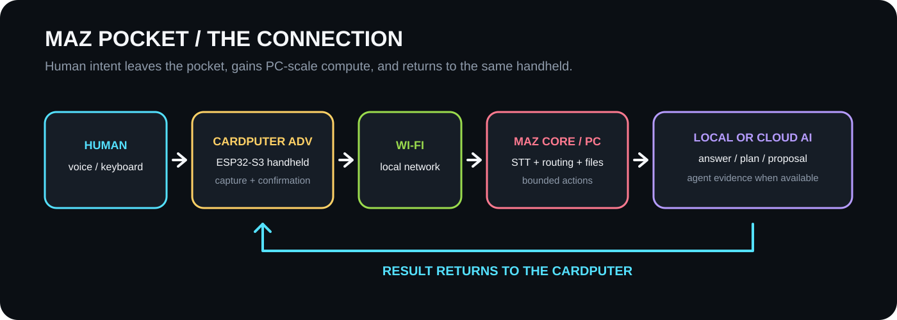

# MAZ Pocket — Make a Connection submission draft

## One-line project

MAZ Pocket turns an M5Stack Cardputer ADV into the physical connection between a human and the heavier AI and agent tools running on a PC.

## The connection

**Human → ESP32-S3 Cardputer ADV → Wi-Fi → MAZ Core on the PC → local or configured cloud AI / agent workflow → result back to the Cardputer.**

The small device handles voice, keyboard input, status and confirmation. The PC handles speech recognition, models, files and agent workflows. This split keeps the handheld immediate while making its useful computing power replaceable and expandable.

## What the build demonstrates

1. **CALL:** hold Space, speak, release, and receive an answer on the Cardputer. Optional speech playback uses the Cardputer speaker.
2. **CAPTURE:** Brain Dump records a thought and sends it to MAZ Core for structured output.
3. **AGENTS:** STATUS shows sourced Agent Nudge state; PLAN creates a plan and cannot execute code.
4. **CONTROL:** the device shows connection state. PC ACTION sends a typed or dictated request through the configured cloud model, displays the validated proposal, and waits for physical confirmation before opening the fixed YouTube page or creating a new Notepad text file.

Only retain statements above in the submitted version when the final physical evidence ledger marks that flow PASS.

## Why it fits Make a Connection

The project makes several normally invisible connections tangible: human intent becomes a physical input; Wi-Fi links a constrained embedded device to a PC; MAZ Core connects that input to local or cloud AI and bounded agent workflows; the result returns to the same handheld. The Cardputer is the visible beginning and end of the chain rather than a decorative remote.

## Engineering decisions

- Heavy compute stays on the PC; the ESP32-S3 remains a responsive interface.
- Existing secondary apps remain accessible but Home exposes four clear surfaces.
- Network/model work runs outside the foreground UI loop.
- Provider failures use stable typed errors instead of leaking raw exceptions.
- PC action proposals are allowlisted, authenticated, expiring, bound to the requesting client and replay-safe.
- The model never supplies an arbitrary URL, path, executable or shell command.
- Each note is a newly created file; existing files are never overwritten.

## Honest limitations

- A PC running MAZ Core is required for AI, speech recognition and PC actions.
- Cloud actions require a configured working cloud route; local CALL depends on a configured local model.
- Network and model availability affect response time.
- The competition candidate is not verified until the physical gate records the exact commit and binary hash passing three consecutive runs.

## Build and source

Hardware: M5Stack Cardputer ADV (ESP32-S3), its integrated keyboard, display, microphone and speaker, a 2.4 GHz Wi-Fi network, and a Windows PC for MAZ Core.

Repository: https://github.com/manazoid4/maz-pocket (publish only after the public-release gate is clear).

Use the repository README and QUICKSTART for installation. Add final commit, release URL, photographs, video embed, BOM and physical results immediately before submission.

## Media placeholders

- Hero photograph: Cardputer on four-tile Home beside the PC.
- Connection diagram: the complete human-to-result chain.
- Video: one continuous CALL or Brain Dump round trip, then PLAN and one confirmed PC action.
- Detail photographs: device screen, integrated keyboard/microphone, and MAZ Core result on the PC.
